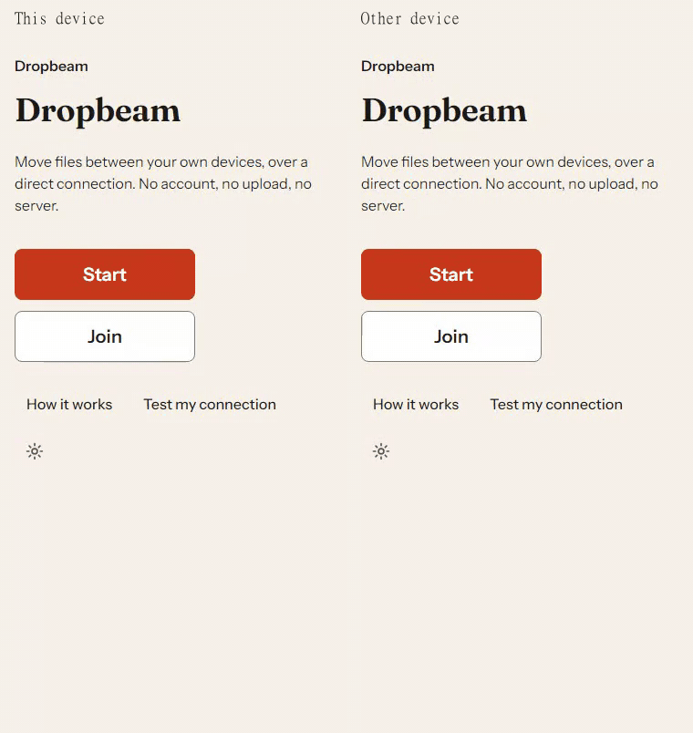

# Dropbeam

Send files straight between your devices, over a direct connection. Nothing is
uploaded — no account, no server, no third-party request.



Both devices open the same static page and pair with a QR code, a link, or a
pasted code. Files and notes then travel directly over a WebRTC data channel on
your local network, verified with SHA-256 on arrival.

## What it does

- **Pair three ways:** QR (with a multi-frame fallback for long codes), link,
  or paste. Every session shows three verification words and waits for the host
  to approve the connection before a single byte moves.
- **Send files and notes:** folders included; per-file progress, speed and ETA;
  cancel any time. Large files are staged through FSA/OPFS so memory stays
  flat.
- **Settings sheet:** theme (system/light/dark), English or Hindi, auto-accept,
  "Across networks" (STUN, off by default), keep-screen-awake, reduce motion and
  an optional device label — nothing but those keys is ever stored.
- **Installs as a PWA:** offline shell, safe update flow, long-press app
  shortcuts (**Send to this device**, **Test my connection**) and a share
  target that takes files _and_ text/URLs from Android's share sheet — staged
  files wait on a Send screen, and shared text waits in the note field,
  until a device is paired.
- **Help built in:** a "How it works" page, a troubleshooting page, and a
  one-tap connection self-test that runs two peers inside the same tab to prove
  WebRTC works in your browser.
- **Nothing leaves the device.** STUN ("Across networks") is off by default;
  even then only your public IP is disclosed to a public STUN server. See
  [docs/PRIVACY.md](docs/PRIVACY.md).

## Quick start

```sh
npm install
npm run dev        # http://localhost:5173 — two tabs pair with each other
```

To try a real transfer, open the app on two devices on the same Wi-Fi (or run
it on one machine and join from a second browser profile).

## Checks

```sh
npm run ci         # the whole gate: every stage in package.json's `gate` list,
                   # in order - see docs/TESTING.md for what each one is
```

Individual scripts: `npm run test` (Vitest), `npm run test:e2e` (Playwright on
Chromium — `E2E_BROWSERS=firefox` for the second engine), `npm run test:webkit`
(the WebKit leg, which cannot run the pairing spec — see docs/INTEROP.md),
`npm run size` (gzip budget), `npm run pwa:health` (installability probe),
`npm run audit:release` (Lighthouse + same-origin network audit).

Current gate: 427 tests green (399 unit/integration + 28 e2e), initial JS
~137.0 KB gz against a 153.6 KB budget, Lighthouse mobile **99 / 100 / 100 /
100** (Performance / Accessibility / Best practices / SEO), and a network audit
over a real pairing + transfer showing only same-origin requests. Both of those
last checks run inside `npm run ci` as `npm run audit:release`: it starts and
stops its own `vite preview` server, and fails the build if performance drops
below 90, accessibility below 95, or a single request leaves the origin.

Those figures are measured rather than typed: the gate reads them out of the run
it just performed and rewrites them itself, so the numbers and the tests they
describe are written by the same run. Under CI the same step checks them instead
of writing, and fails the build if `README.md` is stale.

The same gate runs in CI: on pushes and pull requests, and nightly on a
schedule, since the Linux runner is an environment no local run can prove. The
nightly runs the gate more than once — the other Node line — while a pull
request keeps the single fast leg. Two more legs run the e2e suite on their
own, each for an engine the gate cannot carry: Firefox, and WebKit, which
cannot pair at all. The WebKit leg reports the browser's own capabilities per
platform — the two builds disagree, which is why that table is keyed by
platform rather than by engine.

One thing the nightly cannot yet prove, and says so rather than hiding: Firefox
cannot gather local ICE candidates on the hosted Linux runner at all, so the
pairing specs are excluded from Firefox there and Firefox's leg runs the rest.
The cause is the engine rather than the app — the same gather succeeds in a
plain process on the same machine — and it is written up, with everything that
was ruled out, in [docs/INTEROP.md](docs/INTEROP.md) and
[docs/DECISIONS.md](docs/DECISIONS.md).

## Using it

1. Open Dropbeam on both devices on the same network.
2. On one device press **Start**; on the other press **Join** and scan the code.
3. Check that both screens show the same three words, then allow the
   connection.
4. Drop files or type a note. They move directly, device to device.

Can't connect? The in-app **Troubleshooting** page covers guest networks, VPNs,
the hotspot trick and the browser support table.

## Documentation

- [docs/PRD.md](docs/PRD.md) — product requirements and milestones
- [docs/ARCHITECTURE.md](docs/ARCHITECTURE.md) — how the pieces fit
- [docs/PRIVACY.md](docs/PRIVACY.md) — threat model with linked tests
- [docs/TERMS.md](docs/TERMS.md) — terms of use
- [docs/INTEROP.md](docs/INTEROP.md) — browser interop matrix
- [docs/SELF-HOSTING.md](docs/SELF-HOSTING.md) — deploy guide, STUN/TURN
- [docs/TESTING.md](docs/TESTING.md) — what each test layer covers
- [docs/DECISIONS.md](docs/DECISIONS.md) — every notable build decision
- [LICENSE](LICENSE) — MIT, the terms the code is under
- [THIRD-PARTY-NOTICES.md](THIRD-PARTY-NOTICES.md) — the libraries the bundle ships

## Status

`v1.0.1` — the same app as `v1.0`, with the CI actually running and the
documentation corrected (the two tags differ in no product behaviour; what
changed between them is the CI shape and the record, and
[docs/DECISIONS.md](docs/DECISIONS.md) says what and why).

Everything buildable and testable from a desk is gated by `npm run ci`:
pairing, verification, approval, two-way transfers, the settings sheet, the PWA
shell and the release audit are all covered by 399 unit/integration and
28 e2e tests. M8 is the one milestone with work left, and none of it is code: it
is the hardware rows of the [interop matrix](docs/INTEROP.md), which need two
physical devices on a real network. That matrix, not a commit message, is the
authority on what is still open.

The automated half of the [interop matrix](docs/INTEROP.md) runs **real
engines** — Chromium ↔ Chromium, Chromium ↔ Firefox in both directions,
with real WebRTC over the paste route, plus WebKit on everything that does
not need a peer. What is deliberately _not_ automated, and is listed there
as field QA: the camera QR route, real Wi-Fi / hotspot / guest-network
behaviour, real Safari and iOS (no WebKit build here has ever paired, and the
Windows one's OPFS save path is measured as blocked — see the matrix), and
mobile power/screen behaviour.

The demo animation above is recorded by `node scripts/record-demo.mjs`;
`node scripts/interop-matrix.mjs` re-runs the cross-engine rows and
`node scripts/audit-release.mjs` re-runs the Lighthouse and network
audits. A hidden diagnostic panel ships for field debugging: tap eight
times on the right edge of the screen to see the build id, the service
worker and cache health, the session state, and what the browser can
actually do — WebRTC, save-path support, whether OPFS accepts a write,
and the sink this device would send files to.
